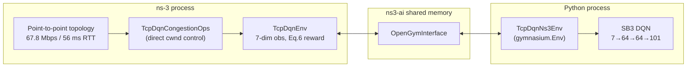

# TCP-DQN on ns-3

[](setup/ns3_version.txt)
[](requirements.txt)
[](LICENSE)
[](#testing)

An independent, packet-level **ns-3** reproduction of **TCP-DQN** — an intelligent TCP congestion control method based on Deep Q-Networks (Wang, Wang & Dong, *Future Internet* 2021). Unlike abstract link models, this project runs real TCP sockets, queues, drops, and RTT measurements in ns-3. A Python DQN agent (Stable-Baselines3) controls the sender congestion window every 0.1 s through the **ns3-ai** shared-memory bridge.

## Table of contents

- [Paper citation](#paper-citation)
- [How it works](#how-it-works)
- [Repository structure](#repository-structure)
- [Prerequisites](#prerequisites)
- [Installation](#installation)
- [Quickstart](#quickstart)
- [Usage / CLI reference](#usage--cli-reference)
- [Configuration](#configuration)
- [Results](#results)
- [Testing](#testing)
- [Known limitations](#known-limitations--deviations-from-the-paper)
- [Future work](#future-work)
- [License](#license)
- [Acknowledgments](#acknowledgments)

## Paper citation

> Wang, Y.; Wang, L.; Dong, X. An Intelligent TCP Congestion Control Method Based on Deep Q Network. *Future Internet* **2021**, *13*, 261.  
> DOI: [https://doi.org/10.3390/fi13100261](https://doi.org/10.3390/fi13100261)

## How it works

### System architecture



### POMDP formulation

| Component | Definition |
|-----------|------------|
| **State** (7 features, every 0.1 s) | relative time, cwnd (segments), bytes in flight, ACK count, avg RTT, throughput, lost segments |
| **Action** | `Discrete(101)` index `i`; delta segments `n = i − 50`; `cwnd ← max(MSS, cwnd + n·MSS)` |
| **Reward** | Eq. (6) below, computed in C++ |
| **Decision interval** | 0.1 s |

```
r_t = α · (T − T_min) / (T_max − T_min) − (1 − α) · (rtt − rtt_min) / (rtt_max − rtt_min)
```

`T_min` is undefined in the paper; we assume **T_min = 0** (see code comments).

### DQN architecture

MLP policy **7 → 64 → 64 → 101**, matching Fig. 3 of the paper. Hyperparameters are in `configs/dqn_default.yaml`.

## Repository structure

```
tcp-dqn-ns3/
├── setup/install_ns3.sh       # WSL2 build: ns-3 + ns3-ai + tcp-dqn
├── setup/ns3_version.txt      # Pinned ns-3 tag (ns-3.48)
├── ns3-module/tcp-dqn/        # Custom contrib module (copied into ns-3/contrib/)
│   ├── model/                 # TcpDqnEnv, TcpDqnCongestionOps
│   ├── helper/                # Topology + install helpers
│   ├── examples/              # tcp-dqn-topology (RL)
│   └── test/                  # ns-3 TestSuite
├── baselines/                 # tcp-dqn-baselines-topology.cc (NewReno/Cubic/HighSpeed)
├── configs/                   # link + DQN YAML defaults
├── python/tcp_dqn/            # Gym wrapper, agent, metrics
├── python/scripts/            # train.py, evaluate.py, run_baseline.py
├── python/tests/              # pytest unit tests
├── docs/BRIDGE_NOTES.md       # Actual ns3-ai API surface (read this first)
├── results/                   # traces, plots, models (generated)
├── setup.bat / run_train.bat  # Windows → WSL launchers
└── README.md
```

## Prerequisites

| Requirement | Notes |
|-------------|-------|
| **OS** | **WSL2 Ubuntu 22.04/24.04** (required — ns3-ai needs POSIX shared memory) |
| **Compiler** | GCC 11+ with C++17 |
| **Build** | `cmake`, `ninja-build`, `build-essential` |
| **Python** | 3.10+ with `venv` |
| **Disk / time** | ~3 GB for ns-3; first build ~20–40 min |

Native Windows (MSVC/MinGW) builds are **not supported**.

## Installation

### From WSL2 Ubuntu

```bash
git clone <repo-url>
cd tcp-dqn-ns3
chmod +x setup/install_ns3.sh
./setup/install_ns3.sh
```

The script will:

1. Verify WSL2 environment
2. Check/install APT dependencies
3. Clone **ns-3.48** and **ns3-ai** (`contrib/ai`)
4. **Copy** (not symlink) `ns3-module/tcp-dqn` → `ns-3/contrib/tcp-dqn`
5. Build ns3-ai, verify `ns3ai_rltcp_gym`, build tcp-dqn targets
6. Create `.venv` and install Python dependencies

### From Windows (convenience)

```bat
setup.bat
```

### ns3-ai Python integration (discovered at build time)

| Item | Value |
|------|-------|
| ns-3 tag | `ns-3.48` (`setup/ns3_version.txt`) |
| ns3-ai path | `ns-3/contrib/ai/` |
| Python import | `import ns3ai_gym_env` |
| Gym env id | `ns3ai_gym_env/Ns3-v0` |

See [docs/BRIDGE_NOTES.md](docs/BRIDGE_NOTES.md) for full bridge details.

## Quickstart

```bash
source .venv/bin/activate
python python/scripts/train.py --timesteps 60000
python python/scripts/evaluate.py
```

Outputs:

| Artifact | Path |
|----------|------|
| Trained model | `results/models/tcp_dqn.zip` |
| Training curve | `results/plots/training_reward_curve.png` |
| Comparison plots | `results/plots/throughput_*.png`, `rtt_*.png`, `packet_loss_comparison.png` |
| Summary table | `results/summary.md` |

**Wall-clock training time:** fill in after running `train.py` on your machine (expect hours with live ns-3 in the loop; 60 000 steps × 0.1 s = 6 000 s simulated time per episode cycle).

## Usage / CLI reference

### `tcp-dqn-topology` (RL)

| Flag | Default | Description |
|------|---------|-------------|
| `--bandwidthMbps` | 67.8 | Link bandwidth |
| `--baseRttMs` | 56.0 | Base RTT (one-way delay = half) |
| `--lossRate` | 0.0001 | Packet error rate (0.01%) |
| `--queuePackets` | 325 | Queue size (≈1× BDP); 0 = auto |
| `--segmentSize` | 1460 | TCP segment size |
| `--simTimeS` | 600 | Simulation duration |
| `--seed` | 42 | RNG seed |
| `--alpha` | 0.5 | Reward α (Eq. 6) |
| `--traceDir` | `results/traces` | CSV output directory |
| `--simSeed` | 0 | ns-3 run number |

### `tcp-dqn-baselines-topology`

Same flags as above, plus:

| Flag | Default | Description |
|------|---------|-------------|
| `--transport_prot` | `NewReno` | `NewReno`, `Cubic`, or `HighSpeed` |

### `python/scripts/train.py`

| Flag | Default | Description |
|------|---------|-------------|
| `--timesteps` | 60000 | SB3 training steps |
| `--link-config` | `configs/link_default.yaml` | Link parameters |
| `--dqn-config` | `configs/dqn_default.yaml` | DQN hyperparameters |
| `--model-out` | `results/models/tcp_dqn` | Model save prefix |
| `--plot-out` | `results/plots/training_reward_curve.png` | Training curve |

### `python/scripts/evaluate.py`

| Flag | Default | Description |
|------|---------|-------------|
| `--model` | `results/models/tcp_dqn.zip` | Trained model |
| `--plots-dir` | `results/plots` | Output plots |
| `--traces-dir` | `results/traces` | CSV traces |
| `--summary-out` | `results/summary.md` | Markdown summary |

## Configuration

### `configs/link_default.yaml`

| Field | Default | Meaning |
|-------|---------|---------|
| `bandwidth_mbps` | 67.8 | Paper measured link |
| `base_rtt_ms` | 56.0 | Paper measured RTT |
| `loss_rate` | 0.0001 | 0.01% packet loss |
| `segment_size` | 1460 | TCP MSS |
| `queue_packets` | 325 | BDP ≈ 474 600 B / 1460 B |
| `sim_time_s` | 600 | Paper plot duration |
| `seed` | 42 | Reproducibility |

### `configs/dqn_default.yaml`

| Field | Default | Paper reference |
|-------|---------|-----------------|
| `gamma` | 0.99 | §5.1 |
| `learning_rate` | 0.0005 | §5.1 |
| `buffer_size` | 50000 | §5.1 |
| `exploration_fraction` | 0.1 | §5.1 |
| `exploration_initial_eps` | 1.0 | §5.1 |
| `exploration_final_eps` | 0.02 | §5.1 |
| `policy_net_arch` | [64, 64] | Fig. 3 |
| `total_timesteps` | 60000 | §5.1 |
| `alpha` | 0.5 | Eq. (6) |
| `time_step_s` | 0.1 | Decision interval |

## Results

After `evaluate.py`, see:

- `results/plots/throughput_comparison.png` — Fig. 4 style
- `results/plots/throughput_cdf.png` — Fig. 5 style
- `results/plots/rtt_comparison.png` — Fig. 6 style
- `results/plots/rtt_cdf.png` — Fig. 7 style
- `results/plots/packet_loss_comparison.png` — Fig. 8 style
- `results/summary.md` — measured means and TCP-DQN speedup

**Quantitative numbers:** fill in after running `evaluate.py`. The paper reports ~2–3× throughput gains; our ns-3 reproduction may differ because we use a simplified two-node topology rather than the authors' WAN between supercomputing centers. Report actual measured numbers honestly in `results/summary.md`.

## Testing

### Python

```bash
source .venv/bin/activate
pytest -v
```

### C++ (from `ns-3/`)

```bash
./ns3 test-runner --suite=tcp-dqn
```

## Known limitations / deviations from the paper

1. **Topology:** single bottleneck point-to-point link vs. real WAN between HPC centers.
2. **T_min:** assumed 0 (undefined in paper).
3. **Single-flow only** — no multi-flow fairness experiments.
4. **ns3-ai version quirks** — documented in [docs/BRIDGE_NOTES.md](docs/BRIDGE_NOTES.md).
5. **Queue model:** `FifoQueueDisc` (drop-tail semantics) via traffic control.
6. **WSL2 required** on Windows hosts.

## Future work

- Multi-flow fairness evaluation
- Mid-episode link condition changes
- Alternative RL algorithms (PPO, discrete SAC)
- Real-hardware validation

## License

MIT — see [LICENSE](LICENSE).

## Acknowledgments

- Wang, Wang & Dong for the original TCP-DQN paper
- The [ns3-ai](https://github.com/hust-diangroup/ns3-ai) project for the C++↔Python bridge
- The [ns-3](https://www.nsnam.org/) consortium

This is an **independent educational reproduction** and is not affiliated with the original authors or the ns3-ai project.
